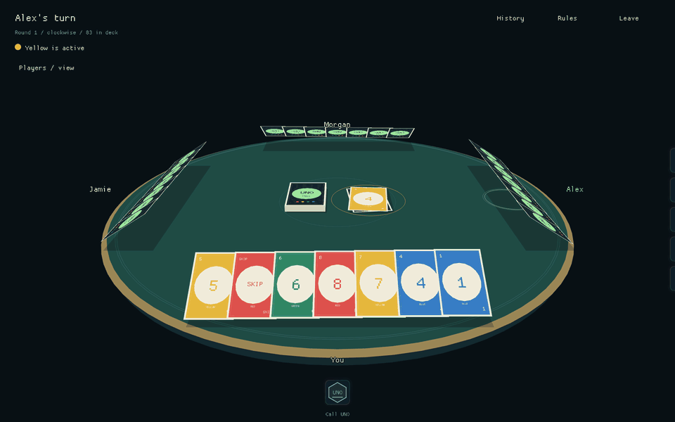

# UNO

A native, player-hosted 3D UNO variant written in Rust for **Windows and macOS**.
Host a table, share a private invite, and play with friends—no accounts, public
backend, or runtime asset downloads.



- **2–10 players** with private hands, draggable cards, and a freely movable 3D camera.
- **House rules:** stacking Draw Twos, one-card draws without passing, and wild `?` cards that make a chosen opponent draw two.
- Wild Draw Four challenges, UNO declarations and catching, and matches to 500 points.
- **Offline self-play:** control every seat in one window. There are no bots.
- Player-hosted multiplayer over LAN or a private VPN, with in-session reconnect.

This is an independent, unofficial implementation, not affiliated with or endorsed
by Mattel. UNO is a Mattel trademark; no official artwork is used.

## Download

Download the latest release—no Rust installation required:

| Platform | Download |
| --- | --- |
| Windows x64 | [Windows ZIP](https://github.com/vibes-work/uno/releases/latest/download/uno-x86_64-pc-windows-msvc.zip) |
| macOS Apple Silicon (M-series) | [Apple Silicon ZIP](https://github.com/vibes-work/uno/releases/latest/download/uno-aarch64-apple-darwin.zip) |
| macOS Intel | [Intel ZIP](https://github.com/vibes-work/uno/releases/latest/download/uno-x86_64-apple-darwin.zip) |

Extract the ZIP, then open `uno.exe` on Windows or `UNO.app` on macOS. Each
package also includes the optional console host and documentation.
[All releases, release notes, and SHA-256 checksums](https://github.com/vibes-work/uno/releases)
are available on GitHub. These links become available after the first release.

Packages are **unsigned/not notarized for distribution**, so macOS Gatekeeper or
Windows SmartScreen may warn or block launching. Only approve builds you trust;
do not disable system security protections globally.

## Build and run

Install [stable Rust](https://rustup.rs/) and your platform's build tools:

- **macOS:** Xcode Command Line Tools (`xcode-select --install`). Apple Silicon and Intel are supported.
- **Windows:** the Rust MSVC toolchain, Visual Studio Build Tools with **Desktop development with C++**, and the Windows SDK.

```sh
cargo run --release --locked --bin uno
```

To build standalone desktop and console-host executables:

```sh
cargo build --release --locked --bins
```

The desktop executable is `target/release/uno` on macOS or
`target\release\uno.exe` on Windows. Built packages do not require Rust, the source
tree, or an assets folder. Build for the recipient's OS and CPU architecture.
See [development and packaging](CONTRIBUTING.md) for `.app` and ZIP packages.

## Start playing

### Try it offline

Select **Self-play**, enter a name, choose **2–10 seats**, and click
**Start self-play**. You control every hand; the view follows the turn.
**Next hand** inspects another seat, and **Turn hand** returns to the active player.
Switching hands does not advance the turn or bypass the rules.

### Play with friends

1. Select **Host a table**, enter your name, and set the invite address to an IP address your friends can reach.
2. Keep the default listen port, **TCP 34197**, unless it is in use. Click **Open table** and allow the appropriate firewall access.
3. Use **Copy invite** and share it privately.
4. Friends select **Join a friend**, paste the invite, enter a name, and click **Take a seat**. Everyone should use the same game version.
5. The host clicks **Deal the cards** once everyone has joined.

Invites look like this (the room token is randomly generated):

```text
uno://192.168.1.20:34197/0123456789abcdef0123456789abcdef
```

Paste invites into the game, not a browser. On the same network, use the host's
LAN address—not `127.0.0.1`. Across networks, prefer an encrypted private VPN.
A link alone cannot bypass NAT or firewalls.

**Security:** game traffic is unencrypted TCP. Treat invites as secrets and play
with trusted people; the host can inspect every hand. Direct internet hosting
requires port forwarding and carries additional risk. See the
[hosting guide](docs/hosting.md) for networking, reconnect limits, Windows setup,
and the optional console host.

## At the table

Drag a card onto the discard pile to play it. Click the deck to draw one card;
normal turns do not end by passing. Arm **Call UNO** before playing your
second-last card.

Use right-drag to orbit, **W A S D** to pan, and the mouse wheel to zoom.
Press **1** or **R** to return to your seat, **2** for an overview, or **3** for a
close view of your cards. Moving the camera never reveals opponents' hands.

- [Rules](docs/rules.md) — deck, house rules, penalties, UNO, and scoring.
- [Controls](docs/controls.md) — camera, card actions, keyboard shortcuts, and self-play.
- [Hosting](docs/hosting.md) — invites, networking, disconnects, and console hosting.
- [Contributing](CONTRIBUTING.md) — checks, source layout, and packaging.

## Limitations

There are no bots, spectators, saved matches, host migration, or seat replacement
during a match. A disconnect pauses the table. Rejoining requires the original
client to remain open; closing the host loses the match.

Packages are not distribution-signed or notarized. Only approve builds you trust;
do not disable Gatekeeper, SmartScreen, or your firewall globally.

## License

[MIT](LICENSE). The license grants no rights to Mattel's trademarks or official artwork.
